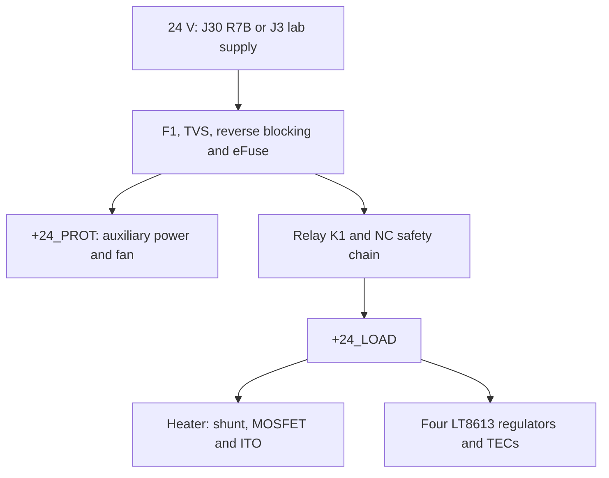

# ITO condensation mirror — detailed project description

Revision L; documentation dated 26 September 2026. This document describes the implemented design. The hardware has not been built or physically qualified.

## 1. Purpose and physical assembly

A 100 × 100 × 1.1 mm ITO glass plate alternates between cooling and resistive heating. Four TEC1-12706 modules cool the rear to bring the surface below the dew point and form condensation. Current through the ITO layer heats the glass to remove condensation as quickly as practical. A reflective coating must remain electrically isolated from the ITO; the PCB design does not specify a coating process.

The ITO specification is 8 Ω/□. Earlier point measurements (approximately 20 Ω across 5 cm, 25 Ω across 9.5 cm and 30 Ω diagonally) include contact/spreading resistance and must not be entered as heater resistance. Measure between complete installed busbars. Copper strips are 5 × 0.5 mm; strain-relieve the wires so they do not bend the glass. Laser patterning is not part of this design.

For ideal parallel busbars, R ≈ Rs × L/W. A square active area would be about 8 Ω, giving an ideal 3 A and 72 W at 24 V. With the estimated 90 mm gap between 5 mm edge busbars and 100 mm width, the existing design estimate is 7.2 Ω and 80 W. These are geometry-based estimates, not measured values or guaranteed warm-up times. Actual geometry, wiring, tolerances, thermal interfaces, water mass and losses determine performance. PWM reduces average power, not on-state current.

## 2. Electrical architecture

The Mean Well GST160A24-R7B is rated 24 V / 6.67 A / 160 W. This prototype has a stricter limit: maximum actual total input current 4 A. Supply capacity does not authorize 160 W operation of the PCB. Firmware L.1 tests at most one TEC at a time and excludes simultaneous heating and cooling.

## 3. R7B input and protection — circuit sheet 02

J30 is a Kycon KPJX-4S PCB socket. Pins 1/4 carry +24_IN and pins 2/3 are return. Manufacturer drawing, footprint and actual pin markings must agree. J3 is a parallel lab-supply input: never connect both sources. F1 is a supplementary 10 A fault fuse, not the 4 A operating limiter.

D1 suppresses transients. Q2 IRLB4030 and Q3 BSS138 form the reverse-block circuitry around U1 TPS26630. The eFuse supplies current limiting, startup control and under-/overvoltage protection. R14=4.02 kΩ sets an approximately 4.5 A nominal limit subject to datasheet spread; operating budget remains 4 A. IMON is converted by R5 and filtered into the MCU input for total current measurement. C5 provides 470 µF bulk capacitance.

U15 combines PGOOD and POWER_ARM, permitting a relay request only once the protected supply is ready. [POWER-AND-STARTUP.md](../POWER-AND-STARTUP.md) records calculated UV/OV/PGOOD thresholds and startup tolerances. Calculations do not replace hotplug and temperature tests.

## 4. Relay and auxiliary supplies — sheets 01 and 03

K1 switches the load rail. J6/J7/J8 form the NC emergency-stop, glass-thermostat and heatsink-thermostat chain. Opening a safety contact must remove relay-coil power. Firmware also monitors LOAD_PRESENT_N. J9 resets the eFuse and is not an emergency stop.

M1 TSR 1-2450 generates 5 V auxiliary power. The XIAO BLE nRF52840 plugs into two seven-pin sockets with USB facing the lower edge. JP1 stays open during USB-powered operation; follow the complete sequence in [ASSEMBLY.md](../ASSEMBLY.md). Do not tie 3.3 V logic and 5 V auxiliary power together.

## 5. ITO heater — sheet 04

U2 UCC27511 drives Q1 STP55NF06L as the low-side heater switch. U3 INA226 measures current through the 10 mΩ RSH1 shunt, supplementing total IMON measurement. TEC_ARM inhibits the heater driver during cooling. Firmware must also zero all TEC enables/setpoints before allowing heating.

Actual heater on-state current must stay below 3.5 A. Initial glass tests start at ≤10 W and ≤2 s pulses, checking temperatures between pulses. Low average current does not establish acceptable peaks. Supplied firmware blocks power tests until calibration data has been entered.

## 6. DAC and TEC channels — sheets 05–10

U4 MCP4728 provides four setpoint voltages. Each channel uses a 10 kΩ/10 kΩ divider and an OPA2333 buffer for ICTRL. With the internal 2.048 V DAC reference and gain 1, nominal maximum after division is approximately 1.024 V. U7 TCA9534 supplies individual enables; U8 combines them with TEC_ARM.

U11–U14 are LT8613 buck regulators. Each has an input fuse, input capacitors, 10 µH inductor, output capacitors, 25 mΩ current shunt and feedback network. ICTRL sets current. All four share the same circuit and schematic layout for easy comparison.

Measured current must remain ≤2 A per channel, including ripple, tolerance and overshoot. DAC code is not a calibrated current without measurement. There is no separate digital current measurement per TEC. TP11–TP14 provide analog test points; qualify using an external meter and scope. Four outputs at 12 V / 2 A require 96 W before losses/auxiliaries and do not fit the 4 A input budget.

## 7. Temperature, fan and ambient sensors — sheets 11–13

U9 ADS1115 reads four 10 kΩ glass NTCs. A fifth hot-side NTC connects to the MCU ADC. Exact probes and curves remain to be selected; firmware beta=3950 K is a placeholder. A mechanically detached but electrically valid sensor is not reliably detectable. Bonding and independent thermostats remain necessary.

J27 supports a suitable 24 V fan with open-collector/open-drain tach. Prototype budget is 0.5 A maximum. Its PWM transistor sinks a control line; this is not a 24 V logic output. Keep warm airflow away from glass and ambient sensing points.

J28/J29 support two remote SHT31 points through four SparkFun QwiicBus EndPoint PCA9615 modules. The main board contains no PCA9615. Each branch needs one local and one remote adapter. Start at 1 m CAT5e/CAT6; qualify the 3 m design target in the actual installation. RJ45 links are not Ethernet/PoE. Follow [REMOTE-SENSORS.md](../REMOTE-SENSORS.md) exactly, especially jumper and 3.3/5 V instructions.

SHT31 addresses are 0x44/0x45. Firmware checks CRC, validity and age, and calculates dew point with the Magnus approximation. Automatic dew-point control is not implemented. Place sensor heads outside hot exhaust and the glass's cold boundary layer, separated from warm adapter boards.

## 8. Firmware and interfaces

[FIRMWARE-INTERFACE.md](../FIRMWARE-INTERFACE.md) lists GPIO functions and internal I²C addresses. [connector-pinout.csv](../connector-pinout.csv) provides physical pin mapping. [firmware/README.md](../firmware/README.md) describes building, flashing, calibration and USB commands.

L.1 is supervised test firmware with explicit commands, latched faults, a watchdog and short pulses. There is no automatic condensation cycle or BLE control. The supplied build blocks power tests by default. Startup drives enables low, zeros DAC/enable registers and checks sensors before permitting a test.

## 9. Thermal design

Hot-side cooling must remove both heat pumped from the glass and TEC electrical input: Qhot = Qcold + Pelectrical. Select cooling capacity from measured heat load, not glass area alone. Use a flat spreader, uniform mechanical pressure and suitable interfaces; the 1.1 mm glass must not act as a structural spring.

Air and water cooling have been considered, but no final heatsink, pump, fan, clamp assembly or guaranteed defogging time is specified. Keep possible water leaks away from electronics/connectors. Measure temperature distribution and thermal stress with the actual glass before allowing faster heating.

## 10. PCB and manufacturing

PCB: 160 × 110 × 1.6 mm, four copper layers at 70/35/35/70 µm. [FABRICATION.md](../FABRICATION.md) specifies manufacturing requirements including filled/capped QFN vias. Use `manufacturing/` Gerbers, drills and assembly files. Local symbols, footprints and 3D models are included.

On 25 September the schematic was redrawn with traditional symbols and explicit wiring on 14 A3 pages. All 202 components and 638 pins matched the previous netlist; copper and firmware were preserved. The English update retains circuit connectivity. ERC/DRC reports are design checks, not physical qualification.

## 11. Remaining qualification

Follow [PROTOTYPE-START.md](../PROTOTYPE-START.md) and enter actual results in [commissioning-results.csv](../commissioning-results.csv). Outstanding work includes mechanical fit, supply startup, sensor curves, ADC/current calibration, TEC code limits, fault response, cable reliability, cooling capacity and glass uniformity. Automatic cycles and four-channel operation follow successful qualification.

## 12. Source management

Current root documents govern revision L. `history-rev-j/` and `history-rev-k/` retain historical reasoning and superseded circuits/budgets; see [archive guide](HISTORICAL-RECORDS.md). The [datasheet index](../datasheets/README.md) maps documents to the BOM. Manufacturer documents retain their copyrights; no new project license has been selected.
