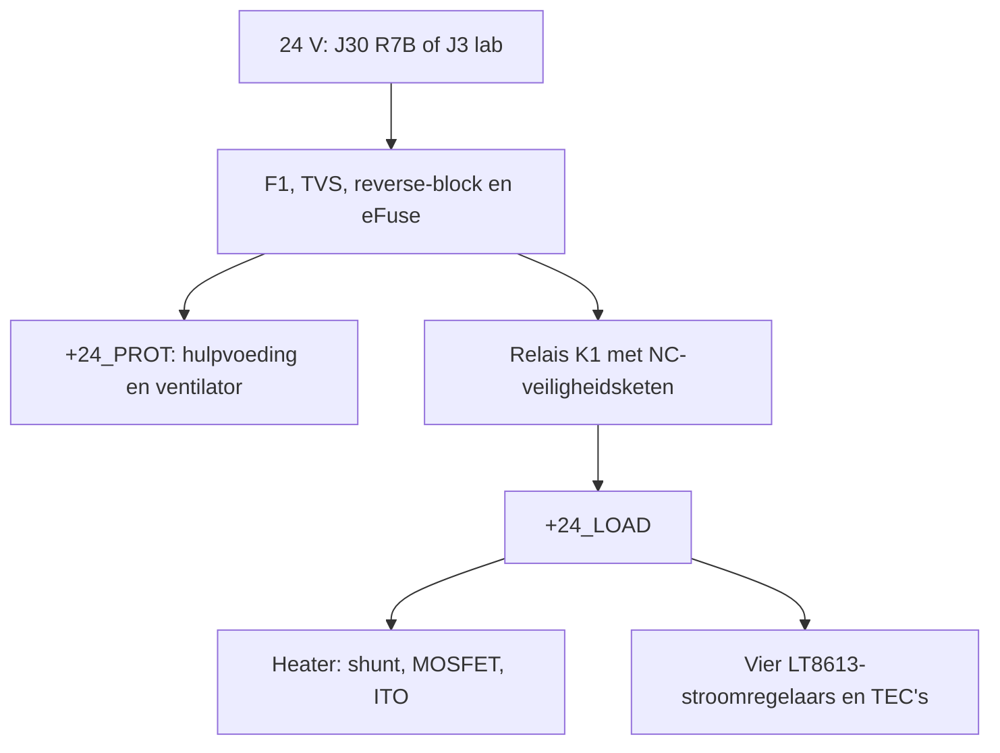

# ITO-condensatiespiegel — gedetailleerde projectbeschrijving

Revisie L; documentatie 26 september 2026. Deze tekst beschrijft het aanwezige ontwerp. De hardware is nog niet gebouwd of fysiek gekwalificeerd.

## 1. Doel en fysieke opbouw

Een ITO-glasplaat van 100 × 100 × 1,1 mm wordt afwisselend gekoeld en elektrisch verwarmd. Vier TEC1-12706-modules koelen de achterzijde om het glas onder het dauwpunt te brengen en condens te vormen. Stroom door de ITO-laag verwarmt het glas om de condens zo snel mogelijk te verwijderen. Een spiegelende coating moet elektrisch geïsoleerd blijven van de ITO-laag; het PCB-ontwerp specificeert het coatingproces niet.

De ITO-specificatie is 8 Ω/□. Eerdere puntmetingen (circa 20 Ω op 5 cm, 25 Ω op 9,5 cm en 30 Ω diagonaal) omvatten contact- en spreidingsweerstand. Ze mogen niet als heaterweerstand in de firmware worden ingevuld. Meet na montage tussen de volledige busbars. De gekozen koperstrips zijn 5 × 0,5 mm; ontlast de aansluitdraden zodat de strips geen buigbelasting op het glas zetten. Laserpatronering maakt geen deel uit van dit ontwerp.

Bij ideale parallelle busbars geldt R ≈ Rs × L/W. Bij een vierkant is dat circa 8 Ω, wat bij 24 V ideaal circa 3 A en 72 W geeft. Dit is een rekenvoorbeeld, geen gemeten vermogen of gegarandeerde opwarmtijd. Werkelijke geometrie, bedrading, toleranties, thermische contactlagen, condensmassa en verliezen bepalen het resultaat. PWM verlaagt het gemiddelde vermogen, maar niet de aanstroom.

## 2. Elektrische architectuur

De Mean Well GST160A24-R7B levert nominaal 24 V / 6,67 A / 160 W. Het huidige prototype heeft een strengere grens: maximaal 4 A werkelijke totale ingangsstroom. De voedingcapaciteit is dus geen toestemming om de print tot 160 W te belasten. De firmware L.1 test maximaal één TEC tegelijk en sluit gelijktijdig verwarmen en koelen uit.

## 3. R7B-ingang en beveiliging — schemablad 02

J30 is de Kycon KPJX-4S-printbus. Pinnen 1 en 4 voeren +24_IN; 2 en 3 zijn retour. De fabrikanttekening, footprint en fysieke pinmarkering moeten overeenkomen. J3 is een parallelle labvoedingsingang: sluit nooit beide voedingsbronnen tegelijk aan. F1 is een aanvullende 10 A foutzekering, geen 4 A bedrijfsbegrenzing.

D1 begrenst transiënten. Q2 IRLB4030 en Q3 BSS138 maken deel uit van de reverse-block-aansturing rond U1 TPS26630. De eFuse verzorgt stroombegrenzing, inschakelregeling en onder-/overspanningsbewaking. R14 = 4,02 kΩ stelt een nominale begrenzing rond 4,5 A in, met datasheetspreiding. Het bedrijfsbudget blijft 4 A. IMON wordt via R5 en een filter naar de MCU geleid voor totale stroommeting. C5 is de 470 µF-bulkcondensator.

PGOOD wordt met POWER_ARM gecombineerd in U15. Zo kan software het relais pas aanvragen wanneer de beschermde rail gereed is. De berekende UV-, OV- en PGOOD-drempels en opstarttoleranties staan in [POWER-AND-STARTUP.md](../POWER-AND-STARTUP.md). Deze berekeningen vervangen geen hotplug- en temperatuurmetingen.

## 4. Relais en hulpvoeding — bladen 01 en 03

K1 schakelt de belastingsrail. J6, J7 en J8 vormen de NC-keten voor noodstop, glasthermostaat en koelblokthermostaat. Een geopende veiligheidsketen moet de relaisspoel uitschakelen. Software gebruikt tevens terugmelding LOAD_PRESENT_N. J9 bedient de eFuse-reset en is geen noodstop.

M1 TSR 1-2450 maakt de 5 V-hulpvoeding. De Seeed XIAO BLE nRF52840 wordt op twee 7-polige sockets gemonteerd, USB naar de onderrand. JP1 blijft bij USB-bedrijf open; de volledige voedingsvolgorde staat in [ASSEMBLY.md](../ASSEMBLY.md). De 3,3 V logica en 5 V-hulprail mogen niet ongecontroleerd worden doorverbonden.

## 5. ITO-heater — blad 04

U2 UCC27511 stuurt Q1 STP55NF06L, de low-side heater-MOSFET. U3 INA226 meet de heaterstroom over RSH1 van 10 mΩ. Deze meting is aanvullend op de totale IMON-meting. TEC_ARM blokkeert de heaterdriver tijdens koelen. De firmware moet ook alle TEC-enables en stroominstellingen op nul zetten voordat verwarmen wordt toegestaan.

Het prototype houdt de werkelijke heater-aanstroom onder 3,5 A. De eerste glasproeven beginnen bij maximaal 10 W en pulsen tot 2 s, met temperatuurcontrole tussen proeven. Een lage gemiddelde stroom bewijst niet dat de stroompieken acceptabel zijn. De firmware start met vermogensvrijgave geblokkeerd totdat kalibratiegegevens zijn ingevuld.

## 6. DAC en TEC-kanalen — bladen 05–10

U4 MCP4728 levert vier instelspanningen. Een 10 kΩ/10 kΩ-deler en OPA2333-buffer per kanaal maken de ICTRL-sturing. De interne DAC-referentie is 2,048 V; met gain 1 is het nominale maximum na deling circa 1,024 V. U7 TCA9534 levert individuele enables; U8 combineert deze met TEC_ARM.

U11–U14 zijn LT8613-buckregelaars. Elk kanaal heeft een eigen zekering, ingangscapaciteiten, spoel van 10 µH, uitgangscapaciteiten, 25 mΩ-stroomshunt en feedbacknetwerk. De stroominstelling is analoog via ICTRL. De vier kanalen hebben dezelfde topologie en dezelfde schemaplaatsing voor vergelijking.

De gemeten stroomgrens per kanaal moet maximaal 2 A blijven, inclusief rimpel, tolerantie en overshoot. Een DAC-code is niet zonder kalibratie gelijk aan een bepaalde stroom. De print heeft geen aparte digitale stroommeting per TEC. TP11–TP14 bieden analoge meetpunten; kwalificatie vereist een externe meter en scope. Vier kanalen op 12 V / 2 A zouden samen al 96 W vragen, exclusief verliezen en hulpvoeding, en passen niet binnen het 4 A-ingangsbudget.

## 7. Temperatuur, ventilator en ambient — bladen 11–13

Vier 10 kΩ-NTC’s op het glas worden via U9 ADS1115 gelezen; een vijfde NTC op de warme kant gaat naar de MCU-ADC. Het exacte probe-type en de temperatuurcurve zijn nog te kiezen: beta = 3950 K in de firmware is een placeholder. Een elektrisch geldige maar losgeraakte sensor kan niet betrouwbaar worden herkend. Mechanische bevestiging en onafhankelijke thermostaten blijven nodig.

J27 is voor een geschikte 24 V-ventilator met open-collector/open-drain tachosignaal. Het prototypebudget is maximaal 0,5 A. De PWM-transistor trekt een stuurlijn naar massa; dit is geen 24 V-logica-uitgang. Houd de warme luchtstroom van glas en ambientmeetpunten weg.

J28/J29 voeden twee externe SHT31-meetpunten via vier SparkFun QwiicBus EndPoint-modules met PCA9615. De hoofdprint zelf bevat geen PCA9615. Iedere tak heeft één lokale en één externe adapter. Begin met 1 m CAT5e/CAT6; het ontwerpdoel van 3 m moet worden gekwalificeerd. De RJ45-verbinding is geen Ethernet/PoE. Volg de jumperinstellingen in [REMOTE-SENSORS.md](../REMOTE-SENSORS.md) exact.

SHT31-adressen zijn 0x44 en 0x45. De firmware controleert CRC, geldigheid en ouderdom, en berekent het dauwpunt met de Magnus-benadering. Dit is nog geen automatische dauwpuntregelaar. Plaats de sensorkoppen buiten de warme uitblaaslucht en de koude grenslaag van het glas, gescheiden van de warmte producerende adapters.

## 8. Firmware en interfaces

[FIRMWARE-INTERFACE.md](../FIRMWARE-INTERFACE.md) bevat alle GPIO-functies en interne I²C-adressen. [connector-pinout.csv](../connector-pinout.csv) is de volledige fysieke pinlijst. [firmware/README.md](../firmware/README.md) beschrijft de build, flashprocedure, kalibratie en USB-opdrachten.

L.1 is bewaakte testfirmware met expliciete opdrachten, vergrendelde fouten, watchdog en korte pulsen. Er is geen automatische condenscyclus of BLE-bediening geïmplementeerd. De meegeleverde build blokkeert vermogensproeven standaard. Opstart zet uitgangsvrijgaven laag, schrijft DAC en enable-registers naar nul en controleert de sensoren voordat een test is toegestaan.

## 9. Warmtehuishouding

De warme zijde moet de van het glas onttrokken warmte plus het elektrische TEC-vermogen afvoeren: Qwarm = Qkoud + Pelektrisch. Een koelblok wordt daarom niet alleen op het glasoppervlak gekozen. Een vlakke warmteverdeler, gelijkmatige mechanische druk en geschikte thermische interfaces zijn noodzakelijk; het 1,1 mm glas mag niet als structurele veer worden belast.

Lucht- en waterkoeling zijn eerder overwogen. Er is in dit pakket nog geen definitieve warmtewisselaar, pomp, fan, klemconstructie of gegarandeerde ontwasemtijd vastgelegd. Een waterlek mag niet bij PCB of aansluitingen kunnen komen. Meet de temperatuurverdeling en thermische spanningen met het werkelijke glas voordat sneller verwarmen wordt vrijgegeven.

## 10. PCB en productie

De print is 160 × 110 × 1,6 mm met vier koperlagen, 70/35/35/70 µm. De fabricagevoorwaarden, waaronder de te vullen/af te dekken QFN-vias, staan in [FABRICATION.md](../FABRICATION.md). Gebruik de Gerbers, boorbestanden en assemblagebestanden uit `manufacturing/`. Het uitgebreide KiCad-project bevat lokale symbolen, footprints en 3D-modellen.

De schematekening is op 25 september herschikt naar traditionele symbolen en expliciete bedrading op 14 A3-bladen. Alle 202 componenten en 638 elektrische pinnen zijn tegen de vorige netlijst vergeleken; PCB-koper en firmware zijn daarbij ongewijzigd. De aanwezige ERC/DRC-rapporten documenteren ontwerpcontroles, geen fysieke kwalificatie.

## 11. Nog te kwalificeren

Volg [PROTOTYPE-START.md](../PROTOTYPE-START.md) en registreer echte resultaten in [commissioning-results.csv](../commissioning-results.csv). Open punten omvatten component-/connectorpassing, voeding en inschakelen, sensorcurves, ADC- en stroomkalibratie, werkelijke TEC-codegrenzen, foutreacties, kabelbetrouwbaarheid, warmteafvoer en glasuniformiteit. Automatische condenscycli en vierkanaalsbedrijf volgen pas na succesvolle kwalificatie.

## 12. Bronbeheer

De huidige documenten in de projectroot zijn leidend. `history-rev-j/` en `history-rev-k/` zijn historisch en bevatten vervallen schakelingen en limieten. [Datasheetindex](../datasheets/README.md) koppelt documenten aan de stuklijst. Fabrikantdocumenten behouden hun eigen auteursrechten; er is geen nieuwe projectlicentie gekozen.
